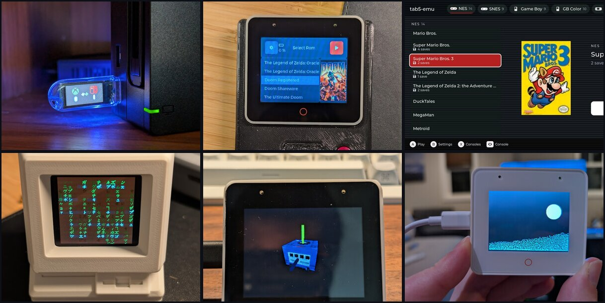
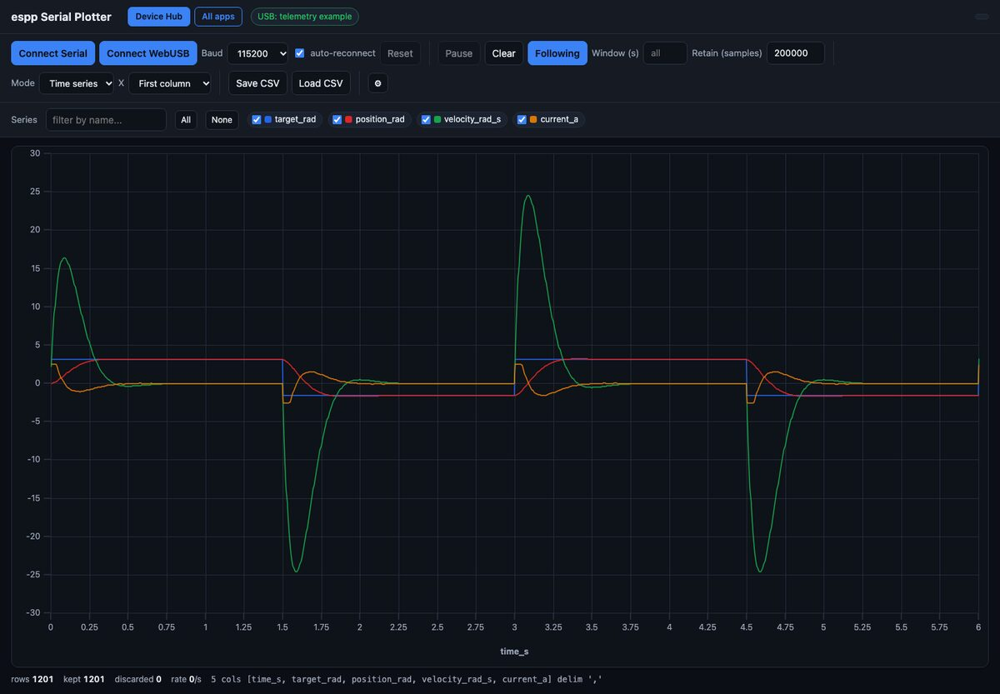
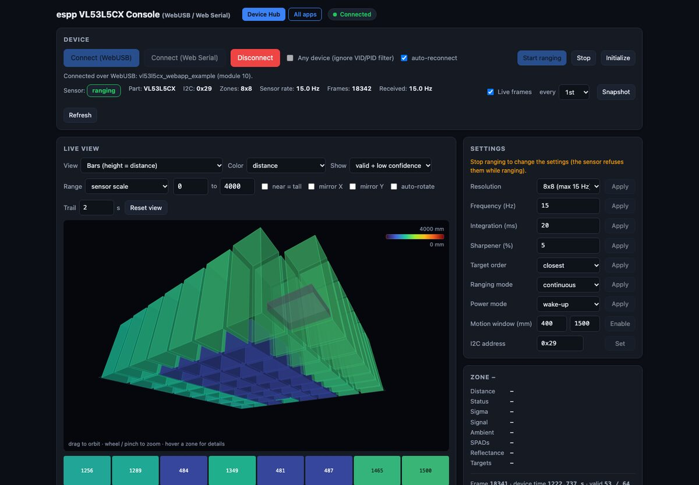
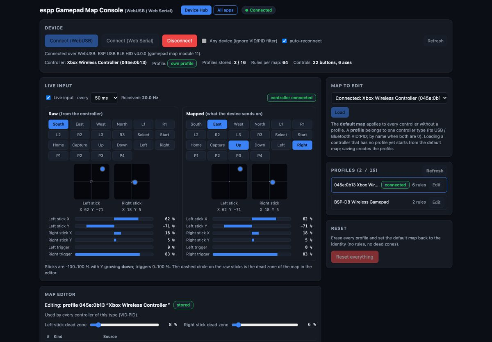
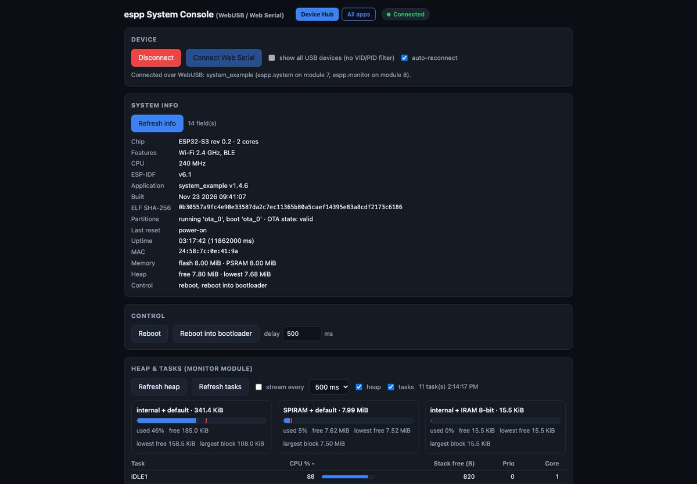

<h1 align="center">Espressif++ (ESPP)</h1>

<p align="center">
  <strong>Modern C++ components for ESP-IDF: drivers, board support, USB, networking, ROS 2 / DDS and browser tools, ready to drop into your project.</strong><br>
  160+ components, published one by one to the ESP Component Registry, most with a working example.
</p>

<p align="center">
  <a href="https://github.com/esp-cpp/espp/releases/latest"></a>
  <a href="https://components.espressif.com/components?q=namespace:espp"></a>
  <a href="https://pypi.org/project/espp/"></a>
  <a href="https://esp-cpp.github.io/espp/"></a>
  <a href="LICENSE"></a>
  <a href="https://discord.gg/dvcQw37xAY"></a>
</p>

<p align="center">
  <a href="https://esp-cpp.github.io/espp/getting_started.html">Get started</a> ·
  <a href="https://esp-cpp.github.io/espp/api_reference.html">Components</a> ·
  <a href="https://esp-cpp.github.io/espp/dev_boards/index.html">Boards</a> ·
  <a href="https://esp-cpp.github.io/espp/apps/index.html">Web apps</a> ·
  <a href="https://esp-cpp.github.io/espp/qemu.html">Run in QEMU</a> ·
  <a href="https://esp-cpp.github.io/espp/">Documentation</a>
</p>

<p align="center">
  <a href="#built-with-espp"></a><br>
  <sub>Built with espp: <a href="https://github.com/finger563/esp-usb-ble-hid">esp-usb-ble-hid</a> · <a href="https://github.com/esp-cpp/esp-box-emu">esp-box-emu</a> · <a href="https://github.com/esp-cpp/tab5-emu">tab5-emu</a> · <a href="https://github.com/finger563/mini-retro-computer">mini-retro-computer</a> · <a href="https://github.com/finger563/esp-simple-3d">esp-simple-3d</a> · <a href="https://github.com/finger563/esp-box-fluidsim">esp-box-fluidsim</a></sub>
</p>

espp is a collection of C++ components for the
[ESP-IDF](https://github.com/espressif/esp-idf) framework. Each one is small,
focused and usable on its own: add `espp/timer` and you get a timer, not a
framework. Almost every component has an `example/` project, and each has a
documentation page with its API reference. Together they cover most of what an ESP32 product
needs: tasks and logging, sensor and display drivers, board support for nearly
30 development boards, USB devices, Wi-Fi / Ethernet / BLE networking, ROS 2
interop, over-the-air updates, and browser tools that talk straight to your
hardware.

The components are built and tested in CI with **ESP-IDF v6.1** on the ESP32,
ESP32-S3, ESP32-C3, ESP32-C6 and ESP32-P4. Each declares the ESP-IDF version it
needs in its manifest (most need 5.x). The portable subset also builds for
**Linux, macOS and Windows**, and ships as a **Python** package.

## Quick start

Add a component to an ESP-IDF project with the component manager:

```console
idf.py add-dependency "espp/timer^1.4"
```

```cpp
#include <chrono>
#include <thread>

#include "logger.hpp"
#include "timer.hpp"

using namespace std::chrono_literals;

extern "C" void app_main(void) {
  espp::Logger logger({.tag = "app", .level = espp::Logger::Verbosity::INFO});

  // runs the callback every 500 ms on its own task; return true to stop
  espp::Timer timer({.name = "heartbeat",
                     .period = 500ms,
                     .callback = [&]() {
                       logger.info("tick");
                       return false;
                     }});

  while (true) {
    std::this_thread::sleep_for(1s);
  }
}
```

Other ways to start:

- **A new project:** create it from the [esp-cpp/template](https://github.com/esp-cpp/template)
  repository (the green **Use this template** button). It is set up for C++ and
  pulls espp components through the component manager.
- **Desktop C++ or Python, no ESP hardware:** `pip install espp`, or
  `find_package(espp)` / FetchContent / CPM from CMake. See
  [Desktop and Python](#desktop-and-python).
- **Every option, including a git submodule:** the
  [Getting started](https://esp-cpp.github.io/espp/getting_started.html) guide.

## What's inside

| Capability | Some of the components | |
|---|---|---|
| **Core & RTOS** | `task`, `timer`, `logger`, `thread_pool`, `event_manager`, `state_machine`, `cli`, `coredump`, `system`, `monitor` | [docs](https://esp-cpp.github.io/espp/api_reference.html#api-core-rtos) |
| **Storage & configuration** | `nvs`, `persistent_data` (versioned settings with migrations), `file_system`, `littlefs`, `sdcard` | [docs](https://esp-cpp.github.io/espp/api_reference.html#api-storage-configuration) |
| **Buses & I/O** | `i2c`, `spi`, `twai` (CAN), `rmt`, `adc`, IO expanders (`mcp23x17`, `aw9523`, `pca9535`…) | [docs](https://esp-cpp.github.io/espp/api_reference.html#api-buses-i-o) |
| **Sensors** | IMUs (`bmi270`, `icm42607`, `lsm6dso`, `qmi8658`, `bno055`…), magnetic encoders (`as5600`, `mt6701`), multizone time-of-flight (`vl53l`), fuel gauges, RTCs, power monitors, GPS | [docs](https://esp-cpp.github.io/espp/api_reference.html#api-sensors) |
| **Motor control** | FOC `bldc_motor` and drivers, `bldc_haptics`, `pid`, `adrc`, `trajectory_planner`, ODrive (`odrive_ascii`, `odrive_native`), CANopen / DS402 (`canopen`), Basicmicro controllers | [docs](https://esp-cpp.github.io/espp/api_reference.html#api-motor-control) |
| **Audio** | `audio`, `codec` | [docs](https://esp-cpp.github.io/espp/api_reference.html#api-audio) |
| **Displays, LEDs & haptics** | `display` + `display_drivers` on LVGL, `led`, `led_strip`, `neopixel`, `drv2605`, `expressive_eyes` | [docs](https://esp-cpp.github.io/espp/api_reference.html#api-displays-leds-haptics) |
| **Input & HID** | touch controllers, `button`, `joystick`, `usb_device` (CDC, HID, MSC, WebUSB, X-Input), `usb_host`, `hid-rp`, `gamepad_map`, `switch_pro`, `switch2_pro` | [docs](https://esp-cpp.github.io/espp/api_reference.html#api-input-hid) |
| **Connectivity & protocols** | `wifi`, `ethernet`, `provisioning`, `socket`, `rtsp`, `rtps` (ROS 2 / DDS), `ble_gatt_server`, `ota`, `dispatcher` + `stream_frame`, `telemetry`, `ftp`, LoRa (`sx126x`, `meshtastic`), NFC | [docs](https://esp-cpp.github.io/espp/api_reference.html#api-connectivity-protocols) |
| **Math & DSP** | `math`, `filters`, `esp-dsp` | [docs](https://esp-cpp.github.io/espp/api_reference.html#api-math-dsp) |
| **Data & serialization** | `serialization`, `cdr`, `cobs`, `csv`, `binary-log`, `reflect_cpp`, `format` | [docs](https://esp-cpp.github.io/espp/api_reference.html#api-data-serialization) |

## Highlights

- **Board support for nearly 30 boards.** One-call setup for the display,
  touch, audio, buttons, IMU and SD card on boards from Espressif, M5Stack,
  LilyGo, Waveshare, Seeed, Adafruit, MotorGo and others: the ESP32-S3-BOX,
  M5Stack Tab5 and Cardputer, LilyGo T-Deck, Waveshare ESP32-P4 boards and more.
  [All boards →](https://esp-cpp.github.io/espp/dev_boards/index.html)
- **ROS 2 on a microcontroller.** `rtps` is an RTPS / DDS stack with
  publishers, subscribers, services and actions that interoperates with ROS 2
  nodes over Fast DDS and Cyclone DDS. CI checks it against ROS 2 Humble and
  Jazzy, and against an emulated ESP32 in QEMU.
  [RTPS →](https://esp-cpp.github.io/espp/protocols/rtps.html)
- **USB the easy way.** `usb_device` builds composite devices (CDC serial, HID,
  mass storage, WebUSB vendor, X-Input) from a config struct, and `usb_host`
  reads HID devices such as gamepads, keyboards and 3D mice.
- **Browser tools for your device.** Self-contained web apps talk to your
  hardware over WebUSB, Web Serial or WebHID, with nothing to install. The
  `dispatcher` lets one USB link serve OTA updates, crash dumps, system info and
  your own modules, and the Device Hub finds the right console for whatever a
  device runs. [Browser tools →](#browser-tools)
- **Run without hardware.** The `qemu` board package brings up the display,
  Ethernet and an SD card in Espressif's QEMU, for development and CI.
  [QEMU guide →](https://esp-cpp.github.io/espp/qemu.html)
- **Desktop and Python too.** Tasks, timers, sockets, RTSP, RTPS, serialization
  and more run on your computer, from C++ or Python.

## Browser tools

The web apps are single HTML files that talk to a device over WebUSB, Web
Serial or WebHID from desktop Chrome or Edge, with nothing to install. Each
espp component that has one keeps it in its `web/` folder, and they are all
published on the [web apps page](https://esp-cpp.github.io/espp/apps/index.html).

<table>
  <tr>
    <td width="50%"><a href="https://esp-cpp.github.io/espp/apps/telemetry.html"></a><br><b>Serial plotter</b> (<code>telemetry</code>): live plots from CSV over a serial port, or binary telemetry over WebUSB</td>
    <td width="50%"><a href="https://esp-cpp.github.io/espp/apps/vl53l5cx_console.html"></a><br><b>VL53L5CX console</b> (<code>vl53l</code>): a multizone time-of-flight sensor in 3D, with its settings</td>
  </tr>
  <tr>
    <td width="50%"><a href="https://esp-cpp.github.io/espp/apps/gamepad_map_console.html"></a><br><b>Gamepad map console</b> (<code>gamepad_map</code>): live input before and after the button map, per-controller profiles</td>
    <td width="50%"><a href="https://esp-cpp.github.io/espp/apps/system_console.html"></a><br><b>System console</b> (<code>system</code>, <code>monitor</code>): chip and firmware info, reboot, heap and tasks</td>
  </tr>
</table>

<sub>The screenshots show the published apps fed with sample data.</sub>

## Desktop and Python

The portable subset of espp (tasks, timers, sockets, RTSP, RTPS, CDR, COBS,
serialization, math and more) builds for Linux, macOS and Windows.

**Python** ([`espp` on PyPI](https://pypi.org/project/espp/)):

```console
pip install espp
```

The [python/](./python) folder has example scripts for timers, tasks, sockets,
RTSP and RTPS.

**C++:** link the `espp::espp` CMake target, which carries the include
directories, the C++23 requirement and the system libraries. Install it and use
`find_package`, or pull it in directly:

```cmake
include(FetchContent)
FetchContent_Declare(espp
  GIT_REPOSITORY https://github.com/esp-cpp/espp.git
  GIT_TAG main
  SOURCE_SUBDIR lib)   # the cross-platform C++ library lives in lib/
FetchContent_MakeAvailable(espp)
target_link_libraries(my_app PRIVATE espp::espp)
```

```sh
# or build + install espp into a prefix (or run lib/build.sh)
cmake -S lib -B build -DESPP_INSTALL=ON -DCMAKE_INSTALL_PREFIX=/path/to/install
cmake --build build --target install
```

```cmake
find_package(espp REQUIRED)
target_link_libraries(my_app PRIVATE espp::espp)
```

[CPM](https://github.com/cpm-cmake/CPM.cmake) works the same way
(`CPMAddPackage(NAME espp GITHUB_REPOSITORY esp-cpp/espp GIT_TAG main SOURCE_SUBDIR lib)`).
See [lib/](./lib) for whole-archive linking, versioning and the build scripts,
and [pc/](./pc) for example C++ programs that use the installed package.

## Built with espp

| Project | What it is |
|---|---|
| [esp-box-emu](https://github.com/esp-cpp/esp-box-emu) | Retro game emulators (NES, Game Boy, Genesis, MSX, Doom, Dark Forces…) on the ESP32-S3-BOX with a custom gamepad |
| [tab5-emu](https://github.com/esp-cpp/tab5-emu) | Emulation and games on the M5Stack Tab5 (ESP32-P4) |
| [esp-usb-ble-hid](https://github.com/finger563/esp-usb-ble-hid) | A USB dongle that turns Bluetooth LE gamepads into a wired Switch Pro or Xbox 360 controller, with a browser console |
| [camera-streamer](https://github.com/esp-cpp/camera-streamer) and [camera-display](https://github.com/esp-cpp/camera-display) | An ESP32 TimerCam streaming MJPEG over RTSP, shown on an ESP32-S3-BOX |
| [software-defined-haptics](https://github.com/esp-cpp/software-defined-haptics) | Software-defined haptic knobs on a BLDC motor |
| [wireless-debug-display](https://github.com/esp-cpp/wireless-debug-display) | Plots and logs from another system, sent over UDP to an ESP32 display |
| [mini-retro-computer](https://github.com/finger563/mini-retro-computer) | A tiny retro computer on the ALXV Labs Byte90 or a Waveshare ESP32-S3 Touch LCD |
| [esp-simple-3d](https://github.com/finger563/esp-simple-3d) | A textured 3D renderer on the ESP32-S3-BOX |
| [esp-box-fluidsim](https://github.com/finger563/esp-box-fluidsim) | An interactive fluid simulation on the ESP32-S3-BOX, tilted with its IMU |
| [esp-box-motor-gesture-control](https://github.com/finger563/esp-box-motor-gesture-control) and [esp-motorgo-mini-gesture-control](https://github.com/finger563/esp-motorgo-mini-gesture-control) | ESP32-S3-BOX tilt gestures driving a MotorGo Mini's motors over ESP-NOW |

Built something with espp? Tell us on [Discord](https://discord.gg/dvcQw37xAY).

## Community

Questions, ideas or something to show? Join the Discord:

[](https://discord.gg/dvcQw37xAY)

Bug reports and feature requests go to
[GitHub issues](https://github.com/esp-cpp/espp/issues).

## Contributing

To work on espp itself:

1. Install `clang-format` and [pre-commit](https://pre-commit.com), then run
   `pre-commit install` in the repository so every commit is formatted.
2. Build a component's example from its folder, for example
   `cd components/timer/example && idf.py build`.
3. To build the documentation locally, install Docker, build the image once
   with `docker build -t esp-docs doc`, then run `./build_docs.sh`. The sources
   are in [doc/](./doc); the published site is built by CI.

espp is released under the [MIT License](LICENSE).
