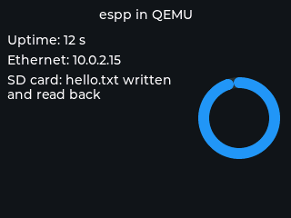

# QEMU Example

This example runs on [Espressif's QEMU](https://github.com/espressif/qemu)
with no hardware, through the `espp::Qemu` BSP. It brings up the three
peripherals the emulator offers and shows them on one screen:

- the virtual RGB panel, as an LVGL display: a title, three status lines and
  an arc that sweeps continuously, so a screenshot or window shows at a glance
  that rendering works;
- the OpenCores Ethernet MAC: a DHCP client on QEMU's user-mode network
  (`10.0.2.15`), its address shown once obtained;
- the SD/MMC host (ESP32 machine only): the attached image is formatted on
  first use, a file is written and read back, and the result is shown.

The log then prints the uptime and free heap every 10 s.



## How to use the example

Install the emulators once (`python $IDF_PATH/tools/idf_tools.py install
qemu-xtensa qemu-riscv32`), then:

```bash
idf.py set-target esp32 build
dd if=/dev/zero bs=1M count=64 of=sd.img
idf.py qemu --graphics --qemu-extra-args "-drive file=sd.img,if=sd,format=raw" monitor
```

`Ctrl-]` quits. For `esp32c3` / `esp32s3`: `idf.py set-target esp32c3 build`
and `idf.py qemu --graphics monitor` (no SD card there). Without a window, e.g.
in CI:

```bash
SDL_VIDEODRIVER=dummy idf.py qemu --graphics monitor
```

Do not use `-nographic` / `-display none` with the display: the panel driver
waits for a display backend to take each drawn area and the first flush would
spin forever. See the [QEMU guide](https://esp-cpp.github.io/espp/qemu.html)
for screenshots, tap networking and GDB.

## Example Output

```
[QEMU Example/I][1.927]: Starting example!
[QEMU Example/I][1.929]: Initializing display...
[QEMU Example/I][2.306]: Initializing Ethernet...
I (2299) esp_eth.netif.netif_glue: 52:54:00:12:34:56
I (2300) esp_eth.netif.netif_glue: ethernet attached to netif
[QEMU Example/I][2.438]: Initializing SD card...
[SdCard/W][2.469]: No FAT filesystem on the card; formatting it
[QEMU Example/I][2.521]: Read back from /sdcard/hello.txt: hello from espp in QEMU, boot 630896 us
I (3453) esp_netif_handlers: eth ip: 10.0.2.15, mask: 255.255.255.0, gw: 10.0.2.2
[QEMU Example/I][3.455]: Ethernet: 10.0.2.15
[QEMU Example/I][12.555]: Uptime 10 s, free heap 149316 bytes, Ethernet up
[QEMU Example/I][22.568]: Uptime 20 s, free heap 149316 bytes, Ethernet up
```
