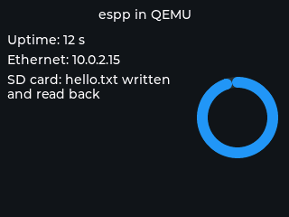

Running espp in QEMU
********************

`Espressif's fork of QEMU <https://github.com/espressif/qemu>`_ emulates the
ESP32, ESP32-C3 and ESP32-S3 well enough to run real firmware with no hardware
at all: on a laptop, in CI, or in a container. This page is the practical
recipe for espp projects; the `QEMU documentation
<https://github.com/espressif/esp-toolchain-docs/blob/main/qemu/README.md>`_
and the `ESP-IDF QEMU guide
<https://docs.espressif.com/projects/esp-idf/en/latest/esp32/api-guides/tools/qemu.html>`_
have the full detail.

What the emulator offers
========================

Emulated on all three targets: the CPU, interrupts and timers, UART, GPIO, the
SPI flash with its MMU and encryption, eFuse and the RNG, the crypto
accelerators, TWAI, an **OpenCores Ethernet MAC** and a **virtual RGB panel**
(neither exists on real silicon). ESP32 only: the **SD/MMC host**, LEDC and
PSRAM. Not emulated anywhere: Wi-Fi, BLE, USB, I2C, I2S, SPI peripherals, RMT.

So the components that gain real coverage are the ones whose target-specific
layer is flash, FreeRTOS, lwIP or one of those peripherals: NVS,
``persistent_data``, ``file_system``, OTA, ``coredump``, ``system``, the socket
components, RTPS, ``sdcard``, and every LVGL user interface. Anything driven
over I2C, I2S, Wi-Fi, BLE or USB (most sensors, codecs and BSPs) cannot run.
Timing is not cycle-accurate: QEMU is for functional and regression tests,
not for performance numbers (memory high-water marks are exact, though).

The :doc:`QEMU board component <dev_boards/other/qemu>` wraps the three virtual
peripherals (display, Ethernet, SD card) with the same shape as the real-board
BSPs, and its example exercises all three.

Install
=======

The emulators install like any other ESP-IDF tool (they are also part of the
``espressif/idf`` Docker image):

.. code-block:: bash

   python $IDF_PATH/tools/idf_tools.py install qemu-xtensa qemu-riscv32
   . $IDF_PATH/export.sh

Run an example
==============

``idf.py qemu`` builds the flash and eFuse images, adds the Ethernet NIC and
runs the right emulator for the configured target:

.. code-block:: bash

   cd components/qemu/example
   idf.py set-target esp32 build
   dd if=/dev/zero bs=1M count=64 of=sd.img     # a blank SD card (ESP32 only)
   idf.py qemu --graphics --qemu-extra-args "-drive file=sd.img,if=sd,format=raw" monitor

``--graphics`` opens the panel window; ``monitor`` attaches ESP-IDF's serial
monitor (``Ctrl-]`` quits). Without the trailing ``monitor``, ``idf.py qemu``
runs the emulator in the foreground with the serial port and the QEMU monitor
multiplexed on the terminal (``Ctrl-A C`` switches between them, ``Ctrl-A X``
quits). For ``esp32c3`` and ``esp32s3`` just ``set-target`` accordingly and
drop the SD drive (QEMU emulates the SD/MMC host on the ESP32 machine only). The same ``idf.py`` flags work for any espp example whose peripherals
are emulated; set ``CONFIG_ETH_USE_OPENETH=y`` (and
``CONFIG_ETH_USE_ESP32_EMAC=n``) in its ``sdkconfig`` to use the emulated NIC.

The display needs a display backend
===================================

The virtual panel's driver hands each drawn area to QEMU and waits for QEMU to
take it. With ``-nographic`` or ``-display none`` nothing ever does, and the
first LVGL flush spins forever: the application appears to hang right after
the display is initialized (verified on the ESP32 and ESP32-C3 machines). Keep
``-display sdl`` (what ``--graphics`` passes) and, for a run without a window,
point SDL at its off-screen driver:

.. code-block:: bash

   SDL_VIDEODRIVER=dummy idf.py qemu --graphics monitor

That is also the form for CI. A screenshot of the panel is one monitor command
away, window or not. Give QEMU a monitor socket (the path must be shorter than
104 bytes) and, while it runs, write the command to that socket from a second
terminal (or background the emulator first and wait for the socket to appear):

.. code-block:: bash

   # terminal 1
   SDL_VIDEODRIVER=dummy idf.py qemu --graphics \
       --qemu-extra-args "-monitor unix:/tmp/mon.sock,server,nowait"

   # terminal 2, once the application is up
   echo "screendump /tmp/shot.ppm" | nc -U /tmp/mon.sock
   magick /tmp/shot.ppm shot.png

   The QEMU example's screen, captured with ``screendump`` from a headless run.

Networking
==========

``idf.py qemu`` adds ``-nic user,model=open_eth``: QEMU's user-mode NAT. The
DHCP client gets ``10.0.2.15``, the host is ``10.0.2.2``, DNS is ``10.0.2.3``.
Outbound TCP and UDP work; a server in the guest needs a port forward
(``--qemu-extra-args "-nic user,model=open_eth,hostfwd=tcp::8080-:80"``); and
**multicast does not cross to the host**, so protocols that discover peers by
multicast (RTPS, mDNS) need a tap device. On Linux:

.. code-block:: bash

   sudo ip tuntap add dev tap0 mode tap user $USER
   sudo ip addr add 192.168.100.1/24 dev tap0
   sudo ip link set tap0 up
   idf.py qemu --graphics --qemu-extra-args "-nic tap,ifname=tap0,script=no,downscript=no,model=open_eth" monitor

with the firmware either serving DHCP (``espp::Qemu::DhcpMode::SERVER``) or
using a static address on that subnet. The emulated MAC has no multicast
address filter (ESP-IDF logs ``add mac address to filter not supported`` when
lwIP joins a group); multicast frames are received regardless.

Debugging
=========

``idf.py qemu gdb`` starts the emulator halted with a GDB server and attaches
GDB; ``idf.py qemu --qemu-extra-args "-d in_asm,cpu"`` traces execution. eFuse
programming (``idf.py qemu efuse-burn ...``) writes a ``qemu_efuse.bin`` next
to the build, so secure-boot and flash-encryption flows can be rehearsed
without touching a real chip.

What to expect from each example
================================

Most espp examples need a board (I2C, I2S, Wi-Fi, USB) and will stop at the
first peripheral that is not emulated. The QEMU board example runs as-is.
Examples built only on the core components and storage (``nvs``,
``persistent_data``, ``file_system``, ``cli`` over the serial console) run
once their project builds for an emulated target; networking examples that
bring up their own board's Ethernet or Wi-Fi need their interface replaced by
``espp::Qemu::initialize_ethernet()`` first. The RTPS interop firmware
(``components/rtps/interop/qemu``) is the worked example: the embedded engine
on the emulated MAC, run by CI in QEMU on a tap device against ROS 2 and the
host engine, with fault injection. Treat a hang right after
display initialization as the missing display backend described above, and a
``not supported`` from ``esp_lcd_new_rgb_qemu`` as the application running on
real hardware.
